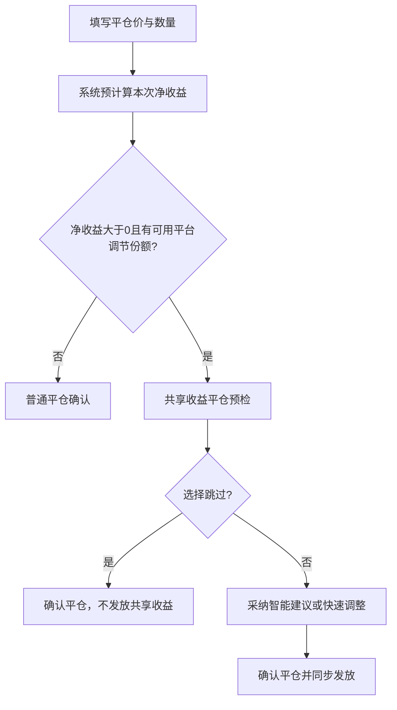

# 52号账本 T+0「共享收益订单」方案（V1）

> **核心决定**：不在开仓时设置共享对象。只有一笔订单填写平仓价与平仓数量、系统已精确计算出**正向净收益**后，才在平仓确认阶段由管理端选择“跳过”或“发放共享收益”。

**方案版本**：V1（盈利平仓预检 + 智能草案 + 人工确认 + 真实订单投影 + 平衡参考）
**适用范围**：52号账本 T+0 速记账本，金额单位为账本内 U，日期统一为北京时间自然日。
**账务边界**：所有行为是账本内可审计的收益归属调整；不直接创建外部支付、提现、借款、还款或强制扣款。

---

## 1. 共享收益的资金来源与边界

共享收益只来自一笔**真实、已盈利、已平仓**订单中预先固化的**平台调节份额**。

```text
订单净收益
= 订单关联用户既有分成
+ 其他普通受益人既有分成
+ 平台调节份额

共享收益发放额 ≤ 本次平仓可用的平台调节份额
```

必须满足：

- 不从任何普通用户、其他受益人或来源订单关联用户的既有收益中扣钱；
- 普通用户既有分成快照、分成比例与到账金额完全不变；
- 未平仓、亏损平仓、打平平仓均不进入共享收益流程；
- 开仓时只固化平台调节份额规则，不指定将来给谁；
- 共享收益只在实际盈利平仓的结算时点发生。

### 例子

某笔盈利平仓订单扣费后净收益为 **100.00 U**：

| 归属 | 发放前 | 发放 4.00 U 共享收益后 | 是否受影响 |
|---|---:|---:|---|
| 订单关联用户既有分成 | 70.00 U | 70.00 U | 不受影响 |
| 其他普通受益人既有分成 | 20.00 U | 20.00 U | 不受影响 |
| 平台调节池 | 10.00 U | 6.00 U | 仅此项减少 |
| 被套用户共享收益 | 0.00 U | 4.00 U | 新增入账 |
| **合计** | **100.00 U** | **100.00 U** | 严格守恒 |

---

## 2. 为什么必须在平仓盈利时才决定

开仓时无法确定最终价格、平仓数量、手续费、FIFO 开仓匹配及真实净收益。平仓参数输入完成后，系统才能准确获得：

- 本次实际净收益；
- 对应哪些开仓订单及其分成快照；
- 本次可动用的平台调节份额；
- 本次共享收益的实际可发放上限。

因此应将原先的**第二次平仓确认**升级为“盈利平仓预检”，而不是新增一套开仓配置流程。



---

## 3. 最重要的交互：平仓时智能、快速地选人和选金额

> 目标不是让管理端每次填写复杂表单，而是让大多数盈利平仓只需 **“跳过”** 或 **“采纳建议并确认”** 两步完成。

### 3.1 平仓预检接口

管理端点击“确认平仓”后，前端先发起一次只读的**平仓收益预检**。服务端一次返回：

- 本次实际净收益；
- 本次可用平台调节份额；
- 是否满足共享收益触发条件；
- 排名前三的候选用户；
- 每位候选人的被套天数、浮亏、XIRR、累计获得/贡献参考；
- 系统建议的发放人数、金额和合计；
- 单笔、单日、单月、单用户额度校验。

只有“净收益为正且可用平台调节份额大于 0”时才显示共享收益预检。候选计算失败或没有合格对象时，自动退化为普通平仓确认，不能阻塞平仓。

### 3.2 弹窗首屏：不展示复杂表格

首屏只保留关键信息：

```text
本单净收益：+50.00 U
可用共享收益：10.00 U
智能建议：Ada · 被套18天 · 建议 +4.00 U
```

底部固定为三个动作：

| 按钮 | 行为 |
|---|---|
| **跳过，直接平仓** | 默认安全出口；正常结算且不创建共享收益。 |
| **采纳建议并确认** | 一键采用系统已填好的对象和金额，完成平仓与共享收益发放。 |
| **调整** | 仅在不同意推荐对象或金额时，展开紧凑候选区。 |

“跳过”应写入一条审计决定，避免同一已结算订单重复弹出共享收益问题；但不影响其原有订单结算。

### 3.3 智能建议默认方案

默认生成一个**推荐一人方案**，避免小额平台调节份额被拆得太散：

```text
建议发放总额
= min(本次可用平台调节份额 × 建议发放比例,
      单笔发放上限,
      目标用户当日/当月剩余额度)
```

初始候选分建议：

| 维度 | 建议权重 | 目的 |
|---|---:|---|
| 被套天数 | 35% | 优先照顾等待较久的持仓。 |
| 当前浮亏程度 | 30% | 优先照顾真实承压更大的订单。 |
| 无收益时长 | 20% | 避免长期没有正向收益的用户被忽略。 |
| 净投入规模 | 10% | 体现实际资金占用。 |
| 共享收益平衡参考 | 5% | 仅轻度调节，不做自动对冲。 |

下列情形直接排除，不只是降低分数：用户或订单无效、没有有效被套订单、单日/单月额度已满、频率限制未到。

> “建议发放比例”“单笔上限”“是否允许多人分配”必须按项目配置，不写死在前端。

### 3.4 调整界面：只看前三名，点一下即可切换

点击“调整”后，仍停留在同一个平仓弹窗，仅展示前三名紧凑候选卡：

```text
Ada     被套 18 天 · 浮亏 −128.60 U · XIRR +58,702%
已获 30 U / 已贡献 8 U                 建议 +4.00 U  [已选]

Ocean   被套 12 天 · 浮亏 −96.20 U · XIRR +1,820%
已获 5 U / 已贡献 18 U                 建议 +3.00 U  [选择]

Mia     被套 9 天 · 浮亏 −88.00 U · XIRR --
已获 0 U / 已贡献 0 U                  建议 +2.00 U  [选择]
```

交互规则：

1. 点击候选卡，即可加入或移出本次方案；
2. 被选人自动填入建议金额，不需要先手打；
3. 仅在必要时修改金额，可使用 `25% / 50% / 75% / 全部` 快捷比例或直接输入固定 U；
4. 超过本次可用平台调节份额时，按钮禁用并即时显示超额；
5. “更多候选人”放在折叠入口，日常平仓无需进入完整名单。

常规动作即为：**看一眼推荐对象 → 采纳建议并确认**。

### 3.5 多人分配仅作为第二层能力

首屏默认推荐 1 人。可用额度较高或管理端选择“多人分配”时，才提供：

- 推荐 2 人：按候选分归一化拆分；
- 推荐 3 人：先满足最低发放金额，再按候选分拆分；
- 手工指定：管理端自行勾选与调整金额。

确认前固定显示总览：

```text
本次共享：Ada +4.00 U、Ocean +3.00 U；合计 7.00 / 可用 10.00 U
```

按钮文案必须包含明确结果：

```text
确认平仓并共享 7.00 U
```

---

## 4. 用户端：真实“共享收益订单”投影

### 4.1 展示方式

受益用户在自己的**交易流水**中看到与普通已结算订单相同卡片、相同详情结构的一笔记录，只多一个标签：

```text
[共享收益订单]
#T0-20261017-001 · ETH · 平多 · 已结算
开仓价 2,400.00    平仓价 2,450.00
数量 1.00 ETH      实际结算 2026/10/17 14:20
订单实际净收益 +50.00 U
本次共享收益   +4.00 U
```

用户可点击进入只读凭证，查看真实来源订单的编号、标的、方向、类型、开平仓价、成交数量、实际结算时间、订单实际净收益及自己的实际共享收益金额。

这样用户确认：收益来自一笔**真实已结算且真实盈利**的订单，不是纸面数据。

### 4.2 严格边界

共享收益订单是**真实来源订单的只读投影**，不是受益用户亲自开仓的订单。因此：

- 不进入受益用户的仓位、均价、数量、FIFO、可平数量或挂单计算；
- 不把来源订单的整笔净收益重复记入受益用户，只将“本次共享收益金额”计入其收益汇总；
- 不允许受益用户编辑、撤回、平仓或删除该投影；
- 来源订单关联用户的姓名、用户名、账户、普通分成比例及其他受益人金额不对受益用户展示；
- 来源订单日后撤回、隐藏或冲正时，投影保留发放时快照并同步显示最新状态；
- 用户端流水名称只显示 **“共享收益”**，不显示“非交易收益”“联合分佣”“待回补”或“回补”。

用户端不显示累计获得、累计贡献、平衡参考、待回补、比例、内部排序、来源用户身份或内部调节信息。面向用户的标题与可选备注不出现“管理员”字样；备注为空时保持空白。

---

## 5. 管理端的平衡参考：不是借还，也不要求对齐

系统为每位用户提供：

```text
累计获得共享收益(user)
= Σ 已入账记录，其中 recipient_user_id = user

累计贡献共享收益(user)
= Σ 已入账记录，其中 source_related_user_id = user

共享收益平衡参考(user)
= 累计获得 − 累计贡献
```

它的用途仅是帮助管理端下一次做人工判断：

- 正数：该用户历史累计获得多于其关联来源订单的累计贡献；
- 负数：该用户关联来源订单累计支持其他人更多；
- 可以作为候选排序的轻度权重；
- 不构成债务、应收、应付或待回补；
- 不需要逐笔匹配、不需要实时对齐；
- 不会自动扣减用户收益、冻结用户订单或产生回补任务。

| 用户 | 累计获得 | 累计贡献 | 平衡参考 | 管理端含义 |
|---|---:|---:|---:|---|
| Ada | 30.00 U | 8.00 U | +22.00 U | 历史获得较多，后续可酌情降低优先级。 |
| Ocean | 5.00 U | 18.00 U | −13.00 U | 历史关联订单贡献较多，后续可酌情提高优先级。 |

---

## 6. 数据模型与事务要求

| 数据结构 | 关键字段 | 用途 |
|---|---|---|
| `ledger52_t0_journal_platform_share_snapshots` | `entry_id`, `opening_entry_id`, `source_user_id`, `related_fund_id`, `platform_percentage`, `matched_quantity`, `available_amount` | 为开/平仓固化平台调节份额，防止以后规则变化影响历史。 |
| `ledger52_t0_shared_income_transfers` | `source_closing_entry_id`, `source_related_user_id`, `recipient_user_id`, `recipient_opening_entry_id`, `amount`, `source_order_snapshot_json`, `status`, `note`, `idempotency_key` | 共享收益发放主记录，同时保存真实订单投影所需快照。 |
| `ledger52_t0_shared_income_decisions` | `closing_entry_id`, `decision`, `reason`, `decided_at` | 记录“已发放 / 已跳过”，避免重复弹窗。 |
| `ledger52_t0_shared_income_audit_events` | 前后金额、动作、时间、原因 | 保留不可变审计，支持排错和冲正。 |
| `ledger52_t0_shared_income_settings` | 等待期、浮亏阈值、额度、建议开关、平衡参考权重 | 保存策略配置。 |

“确认平仓并共享”必须在一个数据库事务中完成：

1. 锁定可平仓数量；
2. 写入真实平仓订单；
3. 计算并固化原有普通分成；
4. 计算本次可用平台调节份额；
5. 校验共享收益计划总额；
6. 写入发放记录、用户端订单投影快照与审计事件；
7. 返回最新订单及收益数据。

任何一步失败，整次平仓与共享收益发放均回滚。确认按钮点击后，后端还需再次校验价格、数量、净收益、候选资格、额度和幂等键，不能直接相信旧预检结果。

---

## 7. 异常与风控

| 场景 | V1 处理方式 |
|---|---|
| 平仓利润 ≤ 0 | 沿用普通平仓确认，不弹出共享收益分配。 |
| 平台调节份额为 0 | 沿用普通平仓确认。 |
| 选择跳过 | 正常平仓，记录跳过决定，不创建共享收益。 |
| 发放总额超限 | 阻止确认并展示可用平台调节额。 |
| 来源订单后来撤回/冲正 | 创建反向冲正事件，不物理删除历史；投影凭证显示最新状态。 |
| 关联被套订单删除 | 历史投影与发放记录保留，解除关联并显示“原关联订单已撤销”。 |
| 重复点击确认 | 业务唯一键、数据库锁和状态机防重。 |
| 预检超时或候选计算失败 | 自动退化为普通平仓确认；“跳过，直接平仓”始终可用。 |
| 用户未来没有盈利 | 不处理；没有待回补、自动扣减或冻结。 |

---

## 8. 实施阶段与验收

### 第一阶段：平仓预检与真实订单投影

- 引入平台调节份额及不可变快照；
- 将盈利平仓第二次确认升级为预检弹窗；
- 支持跳过、选人、金额/比例和多人分配；
- 交易流水新增“共享收益订单”投影；
- 完成权限过滤、事务、幂等、冲正与移动端校验。

### 第二阶段：智能候选与收益调节中心

- 计算被套资格、XIRR、净投入、无收益时长和平衡参考；
- 预检接口返回前三候选人和建议方案；
- 管理端提供待处理、已发放、来源订单贡献、用户平衡参考看板；
- 增加项目级的日/月/单人额度配置。

### 第三阶段：自动草稿（可选）

- 只自动生成候选与建议金额草稿；
- 始终由管理端点击确认才实际写入；
- 不引入自动发放、自动扣减或自动平账。

### 验收标准

1. 只有盈利平仓且有可用平台调节份额时才出现共享收益预检；
2. 常见单人场景可通过“采纳建议并确认”快速完成，不必进入完整候选列表；
3. 可一键跳过，且不影响正常平仓；
4. 确认发放时，平仓、原有分成、共享收益与审计在同一事务内完成；
5. 来源订单普通用户既有分成不变，订单总额严格守恒；
6. 受益用户看到与普通订单同结构的“共享收益订单”，可核对真实已结算来源订单；
7. 共享收益投影不影响受益用户仓位、均价、FIFO、可平数量或挂单；
8. 用户端不显示累计获得、累计贡献、平衡参考、待回补或内部调节逻辑；
9. 平衡参考仅供管理端判断，不自动对齐、不自动平账；
10. 推荐、跳过、调整、确认和冲正均保留审计，重复提交与并发场景验证通过。

---

## 9. 开发前必须确认的业务参数

1. 每个项目中哪一部分既有分成正式映射为“平台调节份额”？该部分不能临时从普通用户既有收益中扣减。
2. 被套资格的等待期、浮亏金额/比例、无收益时长分别设为多少？
3. 建议发放比例、单笔/单日/单月/单用户累计获得上限设为多少？
4. 跳过后是否永久关闭该来源订单的共享收益入口？本方案默认“是”。
5. 是否允许一笔来源订单发放给多人？本方案默认“允许”，总额受可用平台调节份额约束。
